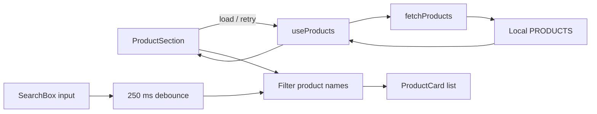
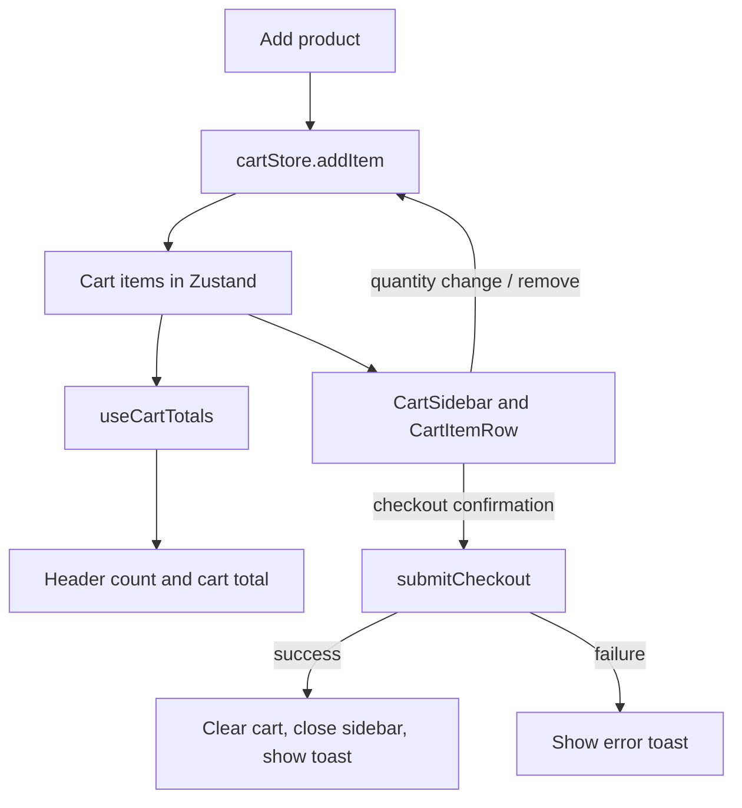

# 精品商店 | Mini Storefront

A small, responsive product storefront built to demonstrate a complete shopping-cart interaction in Next.js. Browse a local product catalog, search by name, adjust cart quantities, and walk through a simulated checkout.

The runnable application is in [`shop/`](shop/). The root [`index.html`](index.html) is a separate, standalone HTML prototype; it is not used by the Next.js app.

## At A Glance

| | |
| --- | --- |
| **Framework** | Next.js 15 with the App Router |
| **UI** | React 19, TypeScript, Tailwind CSS 4 |
| **Client state** | Zustand 5 |
| **Catalog** | Local sample data with a simulated API delay |
| **Language and currency** | Traditional Chinese UI, prices in NT$ |

## Getting Started

### Requirements

- Node.js 18.18 or newer
- npm

### Install and run

```bash
cd shop
npm install
npm run dev
```

Open [http://localhost:3000](http://localhost:3000). Next.js may choose another port if 3000 is already in use and will print the local URL in the terminal.

### Available commands

Run these from the `shop/` directory:

| Command | Purpose |
| --- | --- |
| `npm run dev` | Start the development server |
| `npm run lint` | Run the TypeScript check (`tsc --noEmit`) |
| `npm run build` | Create a production build |
| `npm run start` | Serve the production build; run `npm run build` first |

There is currently no test script configured in `package.json`.

## What You Can Do

- Browse the sample electronics catalog.
- Search product names; filtering is debounced by 250 ms.
- Add products to the cart and change quantities from 1 to 99.
- Review the item count and calculated total.
- Remove items with a confirmation dialog.
- Confirm a simulated checkout and receive success or error feedback.
- Close the cart from its close button, by toggling it in the header, or by clicking outside it. Dialogs can be dismissed with Escape when they are not processing.

## Architecture

The application uses the Next.js App Router. The root route is composed in `shop/src/app/page.tsx`; interactive features live in client components and focused hooks/stores.

```text
shop/src/
├── app/
│   ├── layout.tsx             # Root document, metadata, global stylesheet
│   ├── page.tsx               # Storefront composition
│   └── globals.css            # Tailwind import, theme tokens, animations
├── components/
│   ├── layout/Header.tsx      # Store title and cart toggle/count
│   ├── products/              # Search input, catalog section, product card
│   ├── cart/                   # Cart sidebar and editable item rows
│   └── ui/                     # Confirmation dialog and toast notifications
├── data/products.ts           # Sample catalog records
├── hooks/                     # Product loading, debouncing, totals, Escape key
├── lib/                       # Simulated API and price formatting
├── store/                     # Zustand cart and toast stores
└── types/index.ts             # Shared Product, CartItem, and Toast types
```

### Responsibilities

- **`app/`** assembles the route and document-level configuration.
- **`components/`** renders the storefront and handles user interactions. Product search state and cart-dialog state are local to their owning components.
- **`hooks/`** encapsulates reusable stateful behavior. `useProducts` manages loading/error/retry state; `useCartTotals` derives counts and prices from cart items.
- **`store/`** owns shared, in-memory client state. `cartStore` manages cart contents and visibility; `toastStore` manages transient notifications.
- **`data/` and `lib/api.ts`** provide the sample catalog and mock asynchronous product/checkout operations. Replace this boundary when connecting a real service.
- **`types/`** defines the shared data contracts.

## Data Flow

### Catalog and search



On mount, `useProducts` calls `fetchProducts()`. The current API wrapper waits one second and returns the static `PRODUCTS` array. The section filters product names against a debounced query, then renders one card per match. A failed load is shown with a retry action.

### Cart and checkout



Adding a product increments its existing quantity or inserts it at quantity 1. Quantities are clamped to 0–99; setting one to 0 removes the item. Cart totals are derived from item prices and quantities rather than stored separately. Checkout currently waits 1.5 seconds and succeeds without contacting a payment provider or creating an order.

## Data Model

```ts
interface Product {
  id: number;
  name: string;
  price: number;
  image: string;
}

interface CartItem {
  product: Product;
  quantity: number;
}
```

The catalog is currently defined in [`shop/src/data/products.ts`](shop/src/data/products.ts). Prices are integer amounts formatted as NT dollars by `formatPrice` in [`shop/src/lib/format.ts`](shop/src/lib/format.ts).

## Current Scope And Limitations

- **Demo data:** The product list is local sample data. `fetchProducts` and `submitCheckout` simulate network latency; they are not connected to a backend.
- **No persistence:** Zustand state lives in memory. Refreshing the page clears the cart and notifications.
- **Placeholder imagery:** Product cards and cart rows currently display an image placeholder; the catalog's `image` values are not rendered yet.
- **No real order processing:** Checkout does not validate inventory, collect payment, or persist an order.
- **No automated tests:** A TypeScript check and production build are available, but no test suite is configured.
- **Standalone prototype:** The root `index.html` is an independent static prototype and does not share state or components with `shop/`.

## Extension Points

1. Replace `fetchProducts` and `submitCheckout` in `shop/src/lib/api.ts` with calls to the chosen backend.
2. Decide how product images are hosted, then render the `Product.image` field in the product and cart components.
3. Add persistence or server-backed carts if cart contents should survive reloads or be shared across devices.
4. Add order and payment flows only with the corresponding server-side validation and provider integration.
5. Add unit or end-to-end tests for cart limits, quantity editing, search, dialog behavior, and checkout outcomes.

## Configuration Notes

- The `@/*` import alias points to `shop/src/*` and is configured in `shop/tsconfig.json`.
- Strict TypeScript checking is enabled.
- `shop/next.config.ts` enables React Strict Mode.
- Tailwind CSS 4 is loaded through `shop/src/app/globals.css` and configured via the PostCSS plugin.